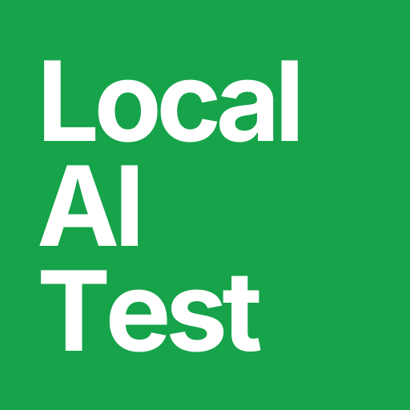
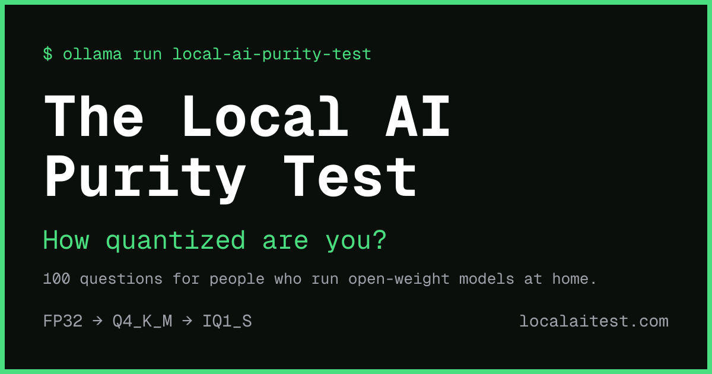
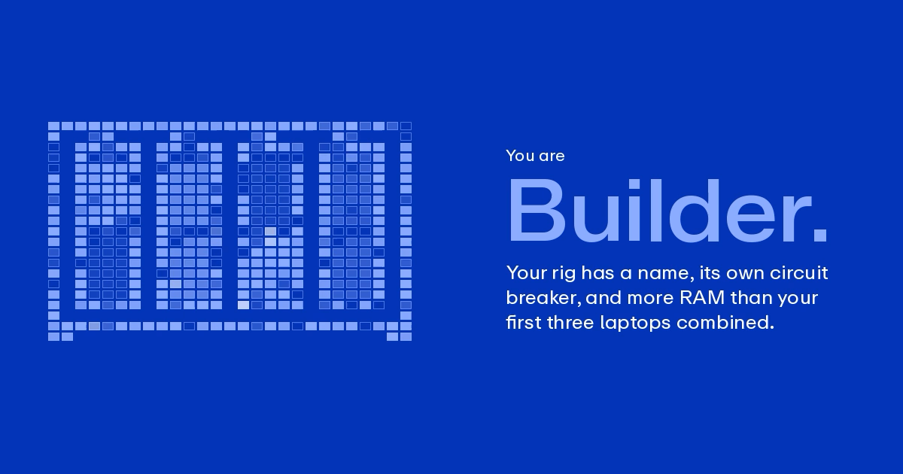

# The Local AI Purity Test

A purity test for people who run open-weight models. Tick everything you've done and your score earns you a rank from Curious to Legend.

**Take it at [localaitest.com](https://localaitest.com)**



## How it works

There are 100 items. Your score is how many you ticked, so higher means more local.

| Score | Rank |
|---|---|
| 0–5 | Curious |
| 6–15 | Enthusiast |
| 16–30 | Explorer |
| 31–45 | Regular |
| 46–60 | Builder |
| 61–75 | Quantizer |
| 76–90 | Power User |
| 91–99 | Legend |
| 100 | ??? |

Every rank has its own animated card with a roast and a score of exactly 0 gets one too. Every score has its own share link (like [`/r/52-rich`](https://localaitest.com/r/52-rich)) and its link preview shows the rank's card.



Share on 𝕏 copies the card and opens a post or opens the share sheet on phones. Download video saves the animated card to attach instead.

### Rig badge

Optionally add your hardware, either read from the hardware listed on your Hugging Face profile or picked by hand. Your total GPU or unified memory earns a badge:

| Total memory | Badge |
|---|---|
| Under 16GB | GPU poor |
| 16–47GB | VRAM middle class |
| 48–191GB | GPU rich |
| 192GB and up | Datacenter in a closet |

### Autofill

Connect GitHub or Hugging Face and the test ticks the items it can prove from your public profile. Each one is tagged "detected via…", so you can untick it.

- **Hugging Face:** your listed hardware (two 3090s, a 64GB or 512GB Mac, a DGX Spark or Strix Halo, two or more Sparks, four or more Sparks), uploaded models, GGUFs, LoRAs, merges and whether your downloads beat your followers
- **GitHub:** starring llama.cpp and opening issues or getting PRs merged in llama.cpp, Ollama or vLLM

### The jokes

- A VRAM bar that fills as you tick items and overflows into "offloading to CPU… 0.4 tok/s"
- A GPU fan and temperature ("Your GPU: 68°C") that climb with your answers
- An "Ask an AI Assistant" button that runs out of CUDA memory
- Jokes on 37 items, shown when you hover over or tick them, including a deliberately bad pelican on a bicycle
- A hidden phrase: type `gguf when` anywhere on the page
- A 404 page that tells you to `ollama pull` it

## Privacy

- Your answers never leave your browser. They're saved on your device only (localStorage) and Reset deletes them.
- Autofill is optional and reads only your public profile.
  - Hugging Face login runs entirely in the browser, with PKCE.
  - GitHub login asks for no permissions. One server route swaps the login code for a token and hands it to the browser in the URL fragment. Nothing is stored or logged and the token is revoked as soon as autofill finishes.
- Share links carry only your score and rig badge.
- No accounts, no analytics and no tracking.

## Stack

- [Next.js 16](https://nextjs.org) (App Router, Cache Components) with TypeScript and [Tailwind CSS 4](https://tailwindcss.com)
- Rank cards are pre-made images and videos in `public/cards` and all 505 result pages are prerendered at build time
- The homepage preview card, favicon and logo are drawn with `next/og`
- Hosted on [Vercel](https://vercel.com)

## Project layout

| Path | What's there |
|---|---|
| `src/data/items.ts` | The 100 items, their jokes and which ones can be autofilled |
| `src/lib/score.ts` | Ranks, roasts, rig badges, result codes and share text |
| `src/lib/rig.ts` | Hugging Face hardware parsing, the device picker list and hardware rules |
| `src/lib/detect.ts` | Browser-side Hugging Face and GitHub lookups |
| `src/lib/oauth.ts`, `src/app/api/auth/github/` | The Connect GitHub and Connect Hugging Face logins |
| `src/lib/og.tsx`, `src/lib/brand-icon.tsx` | The homepage preview card, favicon and logo |
| `src/components/` | The checklist, results page, status bar, autofill panel and popups |
| `public/cards/` | Each rank's card, as a video and a still frame |

## Develop

```bash
npm install
npm run dev
```

Open http://localhost:3000.

```bash
npm test        # rank, rig and share-code unit tests
npm run build   # production build; prerenders all 505 result pages
```

Set `NEXT_PUBLIC_SITE_URL` to override the share-link domain (defaults to `https://localaitest.com`).

The Connect buttons need these environment variables, in `.env.local` locally and in your host's settings for production. Without them the buttons say they "aren't set up yet" and the rest of the test still works.

| Variable | From |
|---|---|
| `GITHUB_CLIENT_ID` | A GitHub OAuth app whose callback is `<site>/api/auth/github/callback` |
| `GITHUB_CLIENT_SECRET` | The same GitHub OAuth app |
| `NEXT_PUBLIC_HF_CLIENT_ID` | A Hugging Face OAuth app with no secret, scopes `openid profile` and redirect `<site>/` |

## Credits

Made by [Pratik](https://x.com/pratikg). Design and rank cards by Estella Xian.

Questions and ideas from [Ivan Fioravanti](https://x.com/ivanfioravanti), [Kydo](https://x.com/0xkydo), [@Spangler3000](https://x.com/Spangler3000) and [David Tai](https://x.com/TheDavidTai).

Inspired by the work of [Tyler](https://x.com/tyler_fong_) and [Sarah](https://x.com/MilksandMatcha) on [sfpurity.com](https://sfpurity.com) and the original [Rice Purity Test](https://en.wikipedia.org/wiki/Rice_Purity_Test).

## License

The code is released under the [MIT License](LICENSE).

The "Local AI Purity Test" name, the localaitest.com domain, the logo and the rank card artwork in `public/cards` are not covered by the license. If you fork this, please give it your own name and look.

The fonts are licensed separately:

- **Geist Mono** is under the [SIL Open Font License 1.1](assets/fonts/OFL-GeistMono.txt).
- **Zalando Sans SemiExpanded** is under the [SIL Open Font License 1.1](assets/fonts/OFL-ZalandoSans.txt). The fixed-weight copies in `assets/fonts`, used for generated images, are renamed "LAT Sans SemiExpanded" as that license requires for modified versions.
- **ABC Repro** is a commercial font from [Dinamo](https://abcdinamo.com), licensed for localaitest.com. It isn't covered by the MIT License, so swap in your own font if you fork this.
